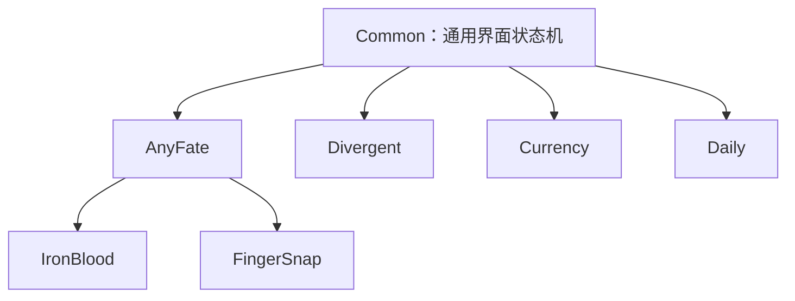

# 项目整体结构与内核

## 1. 项目约束

项目是 Windows 10 2004+ / Windows 11 上的崩坏：星穹铁道自动化工具，建议 2G 以上显存；游戏客户区为 1920×1080、渲染精度 1.0+、关闭 HDR、简体中文（云游戏允许少量边框误差）。程序启动需要管理员权限：游戏/启动器以管理员运行时，非管理员点击会被 Windows 拦截。同一目录只允许一个实例；不引入跨平台抽象或多分辨率适配。

## 2. 目录结构

| 路径 | 作用 |
| --- | --- |
| `new_gui.py` | GUI 入口 |
| `route.py` | `PATHS` 定义、启动时的目录检查 |
| `core/` | 各内核，职责见下节 |
| `tool/` | 键鼠、截图、OCR、mask、日志、录像等共用层 |
| `resource/` | UI、图片、模型、事件、字体等资源 |
| `actions/` | 项目级 JSON 动作脚本 |
| `test/` | unittest 测试；入口和行为在 `test/__init__.py` |
| `docs/development/` | 开发规范 |

## 3. 内核职责

| 内核 | 职责 |
| --- | --- |
| `common` | 公共基座，提供 `StateKernel` / `ScriptKernel` 和通用 JSON 动作循环 |
| `any_fate` | 寰宇蝗灾命途主流程，`iron_blood` / `finger_snap` 的父类 |
| `iron_blood` | 铁血战士（寰宇蝗灾） |
| `finger_snap` | 弹指一挥（寰宇蝗灾） |
| `currency` | 货币战争；后台模式的主要验证对象 |
| `divergent` | 差分宇宙 |
| `daily` | 日常任务 |

## 4. 继承关系

模块级继承关系如下：

实际 Python 继承链：`StateKernel` → `ScriptKernel` → `FateUtils` → `AnyFateUniverse` → `IronBloodUniverse` / `FingerSnap`；`DivergentUniverse` 经 `UniverseUtils(ScriptKernel)`，`DailyKernel(ScriptKernel)`；`CurrencyWar` 经 `SimulatedCurrency` → `CurrencyUtils(StateKernel)`。

模块描述、配置存储和界面入口见[内核配置界面](内核配置界面.md)。

## 5. 后台模式

全局设置 `background_mode` 由 `ScriptKernel` 读取：截图改用窗口捕获（PrintWindow / WGC），键盘改投窗口消息，游戏窗口可以被遮挡但不能最小化。鼠标点击、拖动、滚轮和移动视角仍需要游戏在前台，因此除 `currency` 外，其他内核在后台模式下基本不可用；`currency` 是当前的主要验证对象。

## 6. 坐标约定

动作脚本、日志和配置中的点击/框坐标统一按 1920×1080 客户区、原点在客户区左上角、`[left, top, right, bottom]`（x1, y1, x2, y2）记录。
